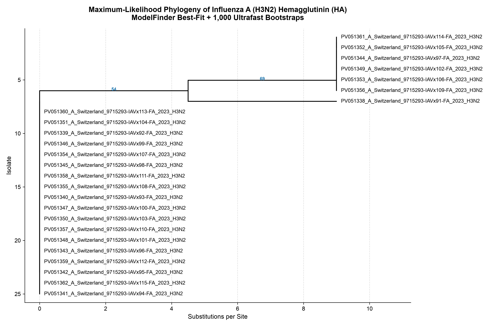
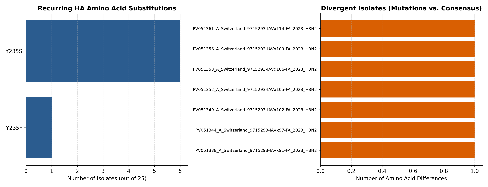

# Pathogen Phylogeny & Selection Pipeline

An end-to-end, reproducible bioinformatics pipeline for retrieving viral coding sequences (CDS), constructing codon-aware multiple sequence alignments, inferring maximum-likelihood phylogenies, and profiling amino acid substitutions.

## Pipeline Architecture
```text
NCBI Entrez API ──▶ ORF QC & Protein Alignment (MAFFT) ──▶ Codon Back-Translation
                                                                    │
   Mutation & Consensus Profiling ◀── ML Phylogeny (IQ-TREE) ◀──────┘
```

## Biological Interpretation (2023 Swiss H3N2 Outbreak Cohort)
* **Dataset:** 25 complete Influenza A (H3N2) Hemagglutinin (HA) coding sequences (`1,698 bp` aligned across `566` amino acid residues) sampled from a 2023 Swiss clinical cohort (`PV051338`–`PV051362`).
* **Clade Structure:** Maximum-likelihood phylogenetic reconstruction (`IQ-TREE`, 1,000 ultrafast bootstraps) resolved a primary basal outbreak cluster (18 identical isolates) alongside a well-supported divergent sub-cluster of 7 isolates (bootstrap support `84%–89%`).
* **Molecular Driver (`Y235S` / `Y235F`):** Consensus-based residue profiling revealed that divergence within this outbreak cohort is driven entirely by non-synonymous substitutions at **HA residue 235**: six isolates carry a polar **Tyrosine-to-Serine (`Y235S`)** substitution, while basal sub-cluster isolate `PV051338` carries an aromatic **Tyrosine-to-Phenylalanine (`Y235F`)** substitution—demonstrating fine-scale micro-evolutionary tracking within a single regional transmission chain.

## Reproducible Setup & Execution
```bash
# 1. Recreate the micromamba environment
micromamba create -f envs/environment.yml
micromamba activate phylo-pipe

# 2. Run the entire end-to-end pipeline
./run_pipeline.sh
```

## Key Visual Outputs

### 1. Maximum-Likelihood Phylogenetic Tree


### 2. Cohort Amino Acid Substitution Profile

